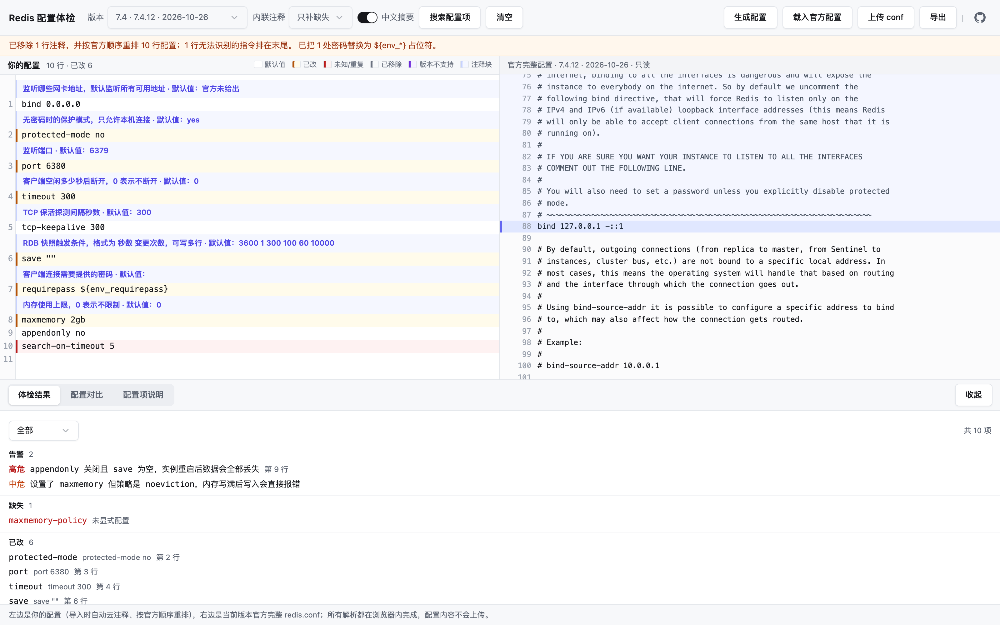
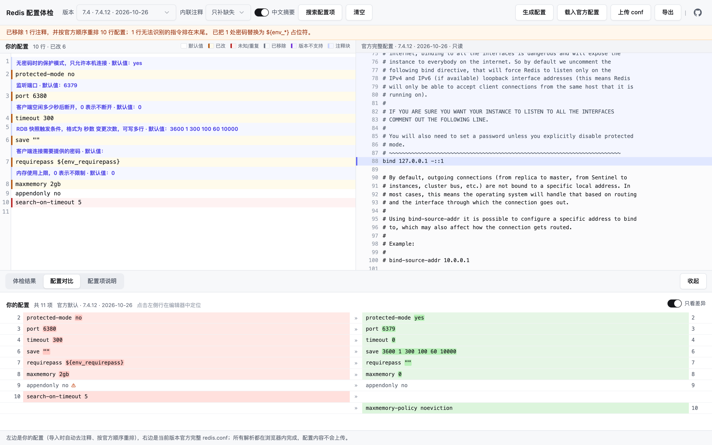
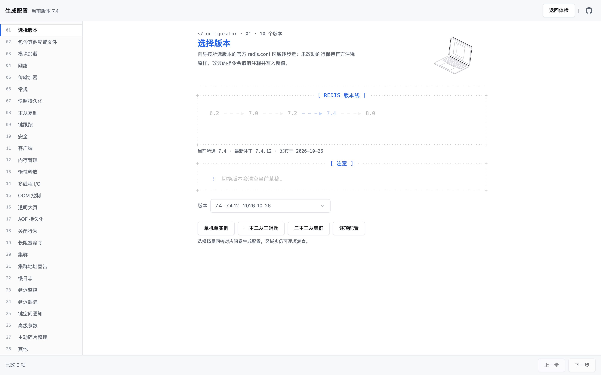

# Redis 配置体检（ZiLucidRedis）

贴入或上传一份 `redis.conf`，逐项对照官方默认值给出体检结果：哪些被改过、哪些不认识、哪些已经废弃、有没有危险组合，并把官方注释补在每一行上方。改完直接导出新的 conf。

纯前端静态站，没有后端，配置内容不会离开浏览器。

线上版本：<https://zilucidredis.zroger.top/>

## 界面







## 快速开始

需要 Node 22.18+。

```bash
npm install
npm run dev        # http://localhost:5173
npm run build      # 构建产物在 dist/
```

构建产物需由静态服务器托管，不能直接 `file://` 打开。

## 文档

| 文档                                                    | 内容                                                 |
| ------------------------------------------------------- | ---------------------------------------------------- |
| [体检页使用](docs/usage.md)                             | 导入、版本、搜索、体检结果、配置对比、导出与密码占位 |
| [生成配置向导](docs/configurator.md)                    | 单机单实例、一主二从三哨兵、三主三从集群与逐项配置   |
| [本地开发与验证](docs/engineering/development.md)       | 开发命令、冒烟、模糊、静态托管与线上发布             |
| [数据来源与字典更新](docs/engineering/data-pipeline.md) | 官方 conf 与 config.c 抓取、字典生成、人工登记表     |
| [功能地图](docs/engineering/feature-map.md)             | 每个功能的入口、选择器与验证方式                     |
